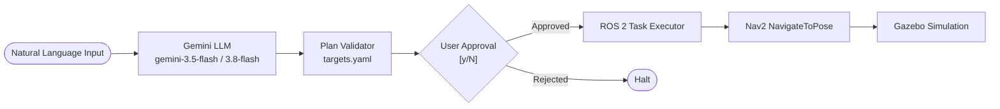

# LLM-Powered Autonomous Mobile Robot

An autonomous mobile robot in **ROS 2 Jazzy** and **Gazebo Harmonic** that converts natural-language user commands into validated, multi-step navigation plans executed through **Nav2**.

---

## Demo

**End-to-End Navigation Demo**

The following demo showcases the complete pipeline: natural-language task planning using Google Gemini, target validation, human approval, and sequential autonomous navigation using ROS 2 and Nav2.

https://github.com/user-attachments/assets/c8aa5a7a-fd5c-44df-91ef-f6fbd63a4b6c

> **Example task:** "Go to the blue cylinder and return home." The robot navigates to the predefined target and then returns home.
---

## Overview

This project bridges natural-language task reasoning with deterministic robotics execution. High-level commands are decomposed by **Google Gemini** into structured, verifiable action sequences. 

To ensure physical robot safety:
- **No direct motor control**: The LLM never touches velocity topics (`/cmd_vel`) or raw hardware.
- **Strict schema & semantic validation**: Every action and target must exist in a verified coordinate registry (`targets.yaml`).
- **Human-in-the-Loop (HITL)**: Robot movement only begins after explicit user confirmation (`[y/N]`).
- **Robust execution & cancellation**: Goals are dispatched sequentially via Nav2 action servers (`NavigateToPose`), aborting immediately on failure, timeout, or user `Ctrl+C` interrupt.

### Key Features
- **Deterministic AI-to-Robot Pipeline**: Natural Language → Structured JSON Plan → Registry Validation → User Confirmation → Sequential Nav2 Execution.
- **Safety & Lifecycle Guards**: Goal cancellation verification on timeout or interrupt; immediate stop on target rejection.
- **Full ROS 2 / Gazebo Harmonic Stack**: Differential drive control, 2D LiDAR simulation, AMCL localization, and local/global costmap inflation layers.
- **Extensible Environments**: Pre-mapped default obstacle world with ongoing support for multi-room indoor office layouts.

---

## Architecture



---

## Tech Stack

- **Robotics & Simulation**: ROS 2 Jazzy, Gazebo Harmonic, Nav2, `ros2_control`, `slam_toolbox`
- **Languages & Frameworks**: Python 3.12, URDF / Xacro, PyTest
- **AI Task Planning**: Google GenAI SDK (`google-genai`), Gemini API

---

## Setup & Run

### 1. Installation
```bash
# Clone workspace repository
git clone https://github.com/tanmay-madaan/llm-mobile-robot.git ~/llm_robot_ws
cd ~/llm_robot_ws

# Install Python dependencies
pip install google-genai pyyaml

# Build and source
source /opt/ros/jazzy/setup.bash
colcon build
source install/setup.bash
```

### 2. Set API Key
```bash
export GEMINI_API_KEY="your-gemini-api-key"
```

### 3. Launch Simulation & Navigation
In **Terminal 1**:
```bash
source /opt/ros/jazzy/setup.bash
source ~/llm_robot_ws/install/setup.bash
ros2 launch llm_robot_nav bringup.launch.py
```
*(Spawns the robot in Gazebo, initializes controllers, launches RViz, and brings up Nav2).*

### 4. Run Interactive Task Planner
In **Terminal 2**:
```bash
source /opt/ros/jazzy/setup.bash
source ~/llm_robot_ws/install/setup.bash
ros2 run llm_robot_planner plan_task
```

---

## Example Session

```text
=======================================================
     LLM Autonomous Task Planner (ROS 2 / Nav2)     
=======================================================

Enter your natural-language task (or 'exit' to quit): Go to the blue cylinder and then return home

[INFO] Generating and validating plan with Gemini...

---------------------------------------------
             PROPOSED PLAN
---------------------------------------------
  Step 1: navigate_to_target -> target: 'blue_cylinder'
  Step 2: navigate_to_target -> target: 'home'
---------------------------------------------

Do you want the robot to execute this plan? [y/N]: y

[INFO] Plan approved! Initializing ROS 2 executor...
[INFO] Executing navigation step to 'blue_cylinder'...
[INFO] Goal for 'blue_cylinder' accepted. Waiting for result...
[INFO] Step 'blue_cylinder' succeeded!
[INFO] Executing navigation step to 'home'...
[INFO] Goal for 'home' accepted. Waiting for result...
[INFO] Step 'home' succeeded!

[SUCCESS] All plan steps executed successfully!
```

---

## Testing

The planner package includes unit and integration tests covering plan validation, target verification, execution timeout, Ctrl+C cancellation, and mock API handling:

```bash
cd ~/llm_robot_ws
source /opt/ros/jazzy/setup.bash
source install/setup.bash
pytest src/llm_robot_planner/test/ -v
```

**Result**: 39 passing tests across schema validation, executor state transitions, cancellation guarantees, Gemini client integration, and the CLI interface.

---

## Honest Limitations

- **Predefined Targets**: The robot navigates between verified waypoints registered in `targets.yaml` (`home`, `red_box`, `blue_cylinder`, `green_box`); it does not perform real-time open-vocabulary visual object detection.
- **Fixed Map**: Operates in static 2D occupancy grid maps generated via SLAM.
- **Simulation Only**: Validated in Gazebo Harmonic simulation; physical hardware deployment has not been conducted.
