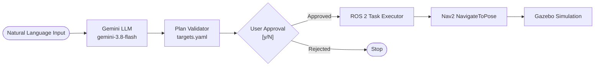

# LLM-Powered Autonomous Mobile Robot

An autonomous mobile robot in **ROS 2 Jazzy** and **Gazebo Harmonic** that converts natural-language user commands into validated, multi-step navigation plans executed through **Nav2**.

---

## Overview

This project connects natural language understanding with deterministic robotics execution. High-level commands (e.g., *"Go to the blue cylinder and then return home"*) are translated by **Google Gemini** (`gemini-3.8-flash`) into structured action sequences. Before motion begins, plans undergo schema and target validation, followed by explicit user confirmation. Navigation is executed through standard Nav2 action interfaces (`NavigateToPose`).

### Key Features
- **Safety-First Architecture**: The LLM only handles high-level planning. It has no direct access to velocity topics (`/cmd_vel`) or raw hardware commands.
- **Plan Validation**: Automatically checks that all actions and target locations exist in the verified target registry before execution.
- **Human-in-the-Loop Approval**: Displays the decomposed plan for user review and explicit confirmation (`[y/N]`) before moving the robot.
- **Deterministic Execution**: Sequentially runs navigation goals through Nav2 action clients, halting immediately if a goal is rejected or aborted.
- **Simulation Tested**: Fully integrated with differential-drive control, 2D LiDAR, AMCL localization, and costmap obstacle avoidance.

---

## Architecture



---

## Tech Stack

- **Robotics & Simulation**: ROS 2 Jazzy, Gazebo Harmonic, Nav2, `ros2_control`
- **Language & Frameworks**: Python 3.12, URDF / Xacro
- **AI Task Planning**: Google GenAI SDK (`google-genai`), Gemini 3.8 Flash (`gemini-3.8-flash`)

---

## Setup & Run

### 1. Installation
```bash
# Clone workspace repository
git clone https://github.com/tanmay-madaan/llm-mobile-robot.git ~/llm_robot_ws
cd ~/llm_robot_ws

# Install Python dependencies
pip install google-genai pyyaml

# Build and source
source /opt/ros/jazzy/setup.bash
colcon build
source install/setup.bash
```

### 2. Set API Key
```bash
export GEMINI_API_KEY="your-gemini-api-key"
```

### 3. Launch Simulation & Navigation
In terminal 1:
```bash
source /opt/ros/jazzy/setup.bash
source ~/llm_robot_ws/install/setup.bash
ros2 launch llm_robot_nav bringup.launch.py
```

### 4. Run Interactive Task Planner
In terminal 2:
```bash
source /opt/ros/jazzy/setup.bash
source ~/llm_robot_ws/install/setup.bash
export GEMINI_API_KEY="your-gemini-api-key"
ros2 run llm_robot_planner plan_task
```

---

## Example Session

```text
=======================================================
     LLM Autonomous Task Planner (ROS 2 / Nav2)     
=======================================================

Enter your natural-language task (or 'exit' to quit): Go to the blue cylinder and then return home

[INFO] Generating and validating plan with Gemini...

---------------------------------------------
             PROPOSED PLAN
---------------------------------------------
  Step 1: navigate_to_target -> target: 'blue_cylinder'
  Step 2: navigate_to_target -> target: 'home'
---------------------------------------------

Do you want the robot to execute this plan? [y/N]: y

[INFO] Plan approved! Initializing ROS 2 executor...
[INFO] Executing navigation step to 'blue_cylinder'...
[INFO] Goal for 'blue_cylinder' accepted. Waiting for result...
[INFO] Step 'blue_cylinder' succeeded!
[INFO] Executing navigation step to 'home'...
[INFO] Goal for 'home' accepted. Waiting for result...
[INFO] Step 'home' succeeded!

[SUCCESS] All plan steps executed successfully!
```

---

## Testing

The planner package includes unit and integration tests covering plan validation, target verification, execution flow, and API error handling using mocks (no Gazebo simulation or active API key required):

```bash
cd ~/llm_robot_ws
source /opt/ros/jazzy/setup.bash
source install/setup.bash
pytest src/llm_robot_planner/test/ -v
```

**Result**: 29 passing tests across schema validation, executor transitions, Gemini client integration, and the CLI interface.

---

## Limitations

- **Predefined Targets**: The robot navigates between known targets registered in `targets.yaml` (`home`, `red_box`, `blue_cylinder`, `green_box`); it does not perform real-time visual object detection.
- **Fixed Map**: Operates in a static 2D occupancy grid map generated via SLAM.
- **Simulation Only**: Validated in Gazebo Harmonic; physical robot deployment has not been performed.
